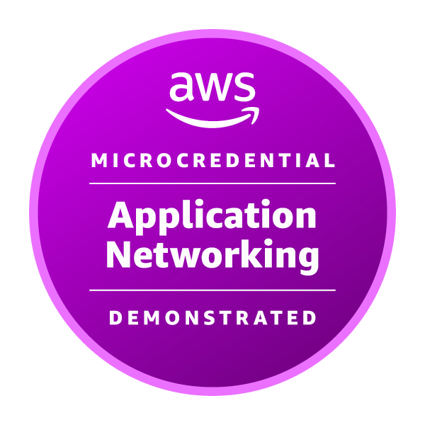

# Nikita Kruglov

### Go Backend Engineer · Distributed Systems · High-Load Systems

I build backend and infrastructure software with Go, focusing on concurrency, networking, correctness, and systems engineering. I also contribute patches to the official Go project.

  
  
  
  
  
  
  
  
  
  
  

[**Go Gerrit — all contributions**](https://go-review.googlesource.com/q/owner:nikkruglov16@gmail.com) · [**My repositories**](https://github.com/NIDJEL?tab=repositories)

---

## Open Source · Go Project Contributor

I contribute to the **official Go project**, including the standard library, HTTP/2 networking, compiler optimizations, developer tooling, and Go infrastructure.

**12 change lists submitted** across the Go ecosystem in the linked review history, including **3 verified upstream merges**. All changes are publicly traceable through [Go Gerrit](https://go-review.googlesource.com/q/owner:nikkruglov16@gmail.com).

### Merged upstream

**1. `database/sql` — concurrency and deadlock prevention**

[**CL 820060 — fix closingMutex writer coordination**](https://go-review.googlesource.com/c/go/+/820060) · [Go issue #81043](https://github.com/golang/go/issues/81043) · **Merged**

Fixed a lost-wakeup race in `closingMutex` writer coordination. A stale atomic state could leave a writer blocked indefinitely, affecting concurrent operations such as `Rows.Next` and `Rows.Close`. Added a regression test and corrected the synchronization logic.

**2. `net/http` — HTTP/2 TLS connection state**

[**CL 829184 — populate Request.TLS from HTTP/2 connection state**](https://go-review.googlesource.com/c/go/+/829184) · [Go issue #81384](https://github.com/golang/go/issues/81384) · **Merged**

Corrected HTTP/2 server behavior so `Request.TLS` reflects the underlying TLS connection, including CONNECT requests and HTTP targets reached over TLS. Added test coverage for TLS and cleartext HTTP/2 connections.

**3. `x/build/internal/gcsfs` — GCS filesystem correctness**

[**CL 828164 — handle explicit GCS folders**](https://go-review.googlesource.com/c/build/+/828164) · [Go issue #81359](https://github.com/golang/go/issues/81359) · **Merged**

Fixed directory listing behavior for explicit GCS folders represented by zero-byte marker objects. Prevented phantom child entries while preserving detection of empty directories.

### Additional submitted changes

These CLs cover compiler optimization, Go tooling, networking, JSON, and testing. **Their live review/merge status is available in Gerrit**; they are not represented here as merged.

| Area | Change list |
| --- | --- |
| Compiler / ARM64 | [CL 827904 — fold broadcasts of inserted scalars](https://go-review.googlesource.com/c/go/+/827904) |
| Go command | [CL 831944 — avoid panic for invalid file lists with atomic coverage](https://go-review.googlesource.com/c/go/+/831944) |
| Go analysis | [CL 826944 — suggest rand.N for durations](https://go-review.googlesource.com/c/tools/+/826944) |
| gopls | [CL 826984 — skip autogenerated compiler details](https://go-review.googlesource.com/c/tools/+/826984) |
| HTTP | [CL 829664 — avoid duplicate body completion after early Close](https://go-review.googlesource.com/c/go/+/829664) |
| JSON | [CL 820080 — preserve EOF after Decoder.More with jsonv2](https://go-review.googlesource.com/c/go/+/820080) |
| Reverse proxy | [CL 823705 — honor ContentLength changes in ModifyResponse](https://go-review.googlesource.com/c/go/+/823705) |
| JSON v2 | [CL 820700 — allow fallbacks to use Go embedding](https://go-review.googlesource.com/c/go/+/820700) |
| Testing | [CL 819980 — distinguish unmatched subtests from no tests](https://go-review.googlesource.com/c/go/+/819980) |

[**Explore all my Go code reviews →**](https://go-review.googlesource.com/q/owner:nikkruglov16@gmail.com)

---

## Verified AWS

### AWS Application Networking Demonstrated

**Amazon Web Services Training and Certification Aug 2026**

Hands-on AWS assessment covering application networking, service-to-service communication, load balancing, container networking, observability, and cloud infrastructure.

  
  
  
  
  
  

**[Verify credential on Credly](https://www.credly.com/badges/ed05c89f-b6ac-4e72-a2d5-eed862dd695a/public_url)**

---

## Selected Projects

### [Vless VPN](https://github.com/NIDJEL/vless-vpn) · Go / Wails / React / sing-box

Windows desktop VPN and proxy client supporting VLESS, SOCKS5, TLS/REALITY, system proxy and TUN modes, process-based split tunneling, subscription management, and connection health checks. Sensitive local configuration is protected with Windows DPAPI.

### [DentVision](https://github.com/NIDJEL/dentvision) · Go / PostgreSQL / Python / FastAPI / YOLO

Dental X-ray analysis application combining a Go REST API, PostgreSQL-backed patient and inference records, a separate Python ML service, and an interactive results interface.

### [loglint](https://github.com/NIDJEL/loglint) · Go / go/analysis / golangci-lint

Custom Go static analyzer for logging conventions and basic sensitive-data checks, with `analysistest` coverage and `golangci-lint` integration.

### [AI Scheduler](https://github.com/NIDJEL/ai-calendar) · Kotlin / Jetpack Compose / GigaChat

Android scheduling application with an LLM-based command parser and a deterministic, local scheduling engine. Calendar changes require explicit confirmation.

---

## Engineering Focus

`Concurrent Programming` · `Distributed Systems` · `Backend Architecture` · `Microservices` · `Networking` · `Databases` · `Performance Engineering` · `Reliability` · `High-Load Systems`

## Credentials

- **AWS Application Networking Demonstrated** — AWS Microcredential · **Verified on Credly**
- **IBM Developer Skills Network** — Docker Essentials: A Developer Introduction

## Current Focus

`Go Standard Library` · `Concurrency & Synchronization` · `Networking / HTTP` · `Backend Infrastructure` · `Performance & Profiling` · `Developer Tooling`
